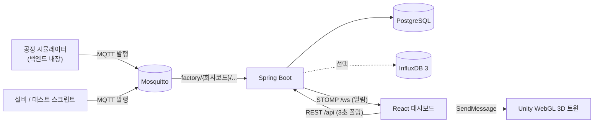

# 현대차 의장공정 디지털 트윈 시스템

현대차 의장공정(도어 장착 → 수밀검사 라인)을 가상으로 재현하고, 공정 데이터를 실시간으로 모니터링하는 **회사별(멀티테넌트) 대시보드**입니다.
국비지원 개발자 과정 팀 프로젝트(2025년 6~7월)로 만들었습니다. 기여자는 GitHub Contributors를 참고해 주세요.

- 공정 시뮬레이터가 MQTT로 설비 데이터를 보내면, 백엔드가 받아서 저장하고 KPI(OEE·FTY·OTD)를 계산합니다.
- React 대시보드에서 KPI, 생산 현황, 환경, 재고, 로봇 상태를 보고, Unity WebGL 3D 화면에서 라인을 확인합니다.
- 회사를 등록하면 회사코드가 발급되고, 같은 회사 사용자끼리만 데이터를 봅니다.

## 구성

```
manufacturing_process/
├── dashboard_backend/          # Spring Boot API 서버 (8080)
├── dashboard_frontend/         # React 대시보드 + Unity WebGL 빌드 (개발 서버 5173)
├── docker-compose.yml          # 전체 스택: PostgreSQL, Mosquitto, 백엔드, 프론트엔드(nginx)
├── Dockerfile                  # backend / frontend 이미지 (멀티 스테이지)
├── nginx.conf                  # 정적 파일 제공 + /api, /ws를 백엔드로 전달
├── .env.example                # 환경변수 예시 (.env로 복사해서 사용)
├── .github/workflows/
│   ├── ci.yml                  # PR·main push마다 빌드와 테스트
│   └── deploy.yml              # EC2 배포 (수동 실행)
├── start_macos.sh / start.ps1  # 개발용 실행 스크립트
├── mqtt_kpi_test.py 등          # MQTT 테스트용 스크립트
└── UNITY_INTEGRATION.md        # Unity ↔ React 연동 설명
```

## 아키텍처



배포 환경에서는 nginx가 프론트엔드 정적 파일을 제공하고 `/api`, `/ws` 요청을 백엔드 컨테이너로 넘깁니다. 그래서 브라우저 입장에서는 한 주소만 씁니다.

## 기술 스택

| 영역 | 사용 기술 |
|---|---|
| Backend | Java 17, Spring Boot 3.5, Spring Security + JWT(jjwt 0.11.5), Spring Data JPA, STOMP WebSocket, Eclipse Paho MQTT |
| Frontend | React 19, Vite 6, React Router 7, ApexCharts, Tabler(CDN), @stomp/stompjs + SockJS |
| 3D | Unity WebGL 빌드 (`dashboard_frontend/public/unity3d`) |
| DB | PostgreSQL 16, InfluxDB 3 (선택) |
| 메시지 | Eclipse Mosquitto 2 |
| 배포 | Docker, GitHub Actions, Docker Hub, AWS EC2 |

## 빠른 실행 (Docker)

Docker와 Docker Compose가 있으면 한 번에 띄울 수 있습니다.

```bash
cp .env.example .env
# .env에서 POSTGRES_PASSWORD, JWT_SECRET 채우기
#   JWT_SECRET 예: openssl rand -base64 48
docker compose up -d --build
```

1. http://localhost 접속
2. **회사 등록** → 발급된 회사코드 확인
3. **회원가입**에서 회사코드 입력 → 로그인
4. **시뮬레이터** 메뉴에서 "시뮬레이션 시작" → MQTT로 공정 데이터가 들어오기 시작합니다

## 개발 모드로 실행

```bash
# 1) DB와 MQTT 브로커만 Docker로
docker compose up -d postgres mosquitto

# 2) 백엔드 (저장소 루트의 .env를 자동으로 읽음)
cd dashboard_backend
./gradlew bootRun

# 3) 프론트엔드 (/api, /ws 요청은 vite 프록시가 localhost:8080으로 전달)
cd dashboard_frontend
npm install
npm run dev        # http://localhost:5173
```

Mosquitto를 PC에 직접 설치했다면 `./start_macos.sh` 또는 `.\start.ps1`로 백엔드·브로커·프론트를 한 번에 띄울 수 있습니다. (PostgreSQL은 따로 필요)

개발용 기능은 운영 빌드에서 꺼집니다.
- API 테스트 화면(`/{회사명}/api-test`): `npm run dev`일 때만
- 테스트 알림 API(`/api/test/**`): 백엔드를 `SPRING_PROFILES_ACTIVE=dev`로 실행할 때만

### 테스트

```bash
cd dashboard_backend && ./gradlew test     # H2 메모리 DB로 실행, 외부 DB·브로커 불필요
cd dashboard_frontend && npm run lint && npm run build
```

## 환경변수

`.env.example`을 `.env`로 복사해서 씁니다. `.env`는 git에 올라가지 않습니다.

| 이름 | 필수 | 설명 |
|---|---|---|
| `POSTGRES_DB`, `POSTGRES_USER`, `POSTGRES_PASSWORD` | ✅ | PostgreSQL 접속 정보 (docker compose와 백엔드가 같이 사용) |
| `JWT_SECRET` | ✅ | JWT 서명 키. 32바이트 이상. 없으면 백엔드가 시작되지 않음 |
| `CORS_ALLOWED_ORIGINS` | | 프론트엔드에 접속하는 주소 (쉼표 구분). 배포 시 서버 주소를 넣기 |
| `DB_URL`, `DB_USERNAME`, `DB_PASSWORD` | | 다른 DB를 쓸 때만. 기본값은 `localhost:5432` + `POSTGRES_*` |
| `MQTT_BROKER_URL`, `MQTT_ENABLED` | | 기본 `tcp://localhost:1883`, `true` |
| `INFLUXDB_URL`, `INFLUXDB_TOKEN`, `INFLUXDB_DATABASE` | | InfluxDB 3를 쓸 때만 |
| `VITE_API_URL` | | 프론트엔드와 백엔드를 서로 다른 주소에 띄울 때만 |
| `VITE_OPENWEATHER_API_KEY` | | 외부 날씨 카드용 |

## 회사별 데이터 분리 (멀티테넌트)

- 회사를 등록하면 8자리 회사코드가 발급되고, 회원가입할 때 이 코드로 회사에 소속됩니다.
- **REST**: 회사별 API는 `/api/{회사명}/...` 형식입니다. 로그인한 사용자의 회사와 주소의 회사가 다르면 403을 돌려줍니다 (`TenantAccessInterceptor`).
- **WebSocket**: STOMP 연결 때 JWT를 확인하고, 알림 토픽 `/topic/alerts/{회사명}`은 자기 회사 것만 구독할 수 있습니다 (`StompAuthChannelInterceptor`).
- **MQTT**: 토픽은 `factory/{회사코드}/...` 형식이고, 회사코드로 DB에서 회사를 찾습니다. 등록되지 않은 코드의 메시지는 버립니다. `/api/mqtt/publish`는 로그인한 사용자의 회사 토픽에만 발행할 수 있습니다.
- 액세스 토큰과 리프레시 토큰은 서로의 용도로 쓸 수 없습니다.

## MQTT 토픽

| 토픽 | 내용 |
|---|---|
| `factory/{코드}/environment` | 온도, 습도, 공기질 |
| `factory/{코드}/robot` | 로봇 상태 (온도, 사이클타임, 전력) |
| `factory/{코드}/{라인}/operations` | KPI 원천 데이터 → OEE·FTY·OTD 계산 |
| `factory/{코드}/{라인}/production/started`, `.../completed` | 생산 시작 / 완료 |
| `factory/{코드}/{라인}/conveyor` | 컨베이어 명령 |
| `factory/{코드}/{라인}/product/moved`, `.../product/arrived/{구역}` | 제품 이동 |
| `factory/{코드}/{라인}/{로봇}/work/started`, `.../work/completed` | 로봇 작업 |
| `factory/{코드}/{라인}/inspection/started`, `.../completed` | 수밀검사 |

테스트 스크립트(`mqtt_kpi_test.py`, `mqtt_test_commands.bat`)에 적힌 회사코드(`g2qj6jvf` 등)는 예전 DB 기준입니다. 직접 쓸 때는 회사 등록 후 받은 코드로 바꿔 주세요.

## KPI 계산

- **OEE** = 가용성(가동시간 ÷ 계획시간) × 성능(목표 사이클타임 ÷ 실제 사이클타임, 최대 100%) × 품질(양품 ÷ 총생산)
- **FTY** = 1차 합격 ÷ 총생산, **OTD** = 납기 준수 ÷ 총생산
- 기준 미달(OEE 70%, FTY 85%, OTD 90% 미만)이면 웹소켓으로 알림을 보냅니다.

## 배포 (AWS EC2)

`.github/workflows/deploy.yml`은 **수동 실행**입니다. (GitHub → Actions → Deploy to EC2 → Run workflow)

1. CI(빌드·테스트) 통과
2. backend / frontend 이미지를 Docker Hub에 push
3. EC2에 `docker-compose.yml` 복사 → `docker compose pull` → `docker compose up -d`

준비할 것
- GitHub Secrets: `DOCKER_HUB_USERNAME`, `DOCKER_HUB_TOKEN`, `HOST`, `USERNAME`, `KEY`, `PORT` (선택: `VITE_OPENWEATHER_API_KEY`)
- EC2: Docker와 Docker Compose 플러그인 설치, `~/factory-app/.env` 생성 (`CORS_ALLOWED_ORIGINS`에 서버 접속 주소 포함)
- 보안 그룹: 80 포트만 열면 됩니다. DB·브로커·백엔드 포트는 서버 안(127.0.0.1)에서만 열립니다.

## 알려진 한계

- **Unity 원본 프로젝트가 저장소에 없습니다.** WebGL 빌드 결과물만 있어서 Unity 쪽 코드는 고칠 수 없습니다.
  - 빌드 안에 백엔드 주소(`http://localhost:8080`)가 고정돼 있어, 배포 환경에서는 Unity가 직접 부르는 API(생산 주문, 문 신호, 컨베이어 상태, 클릭 기록)가 동작하지 않습니다. React가 Unity로 넘기는 실시간 데이터는 정상 동작합니다.
  - Unity가 부르는 API 중 일부(`/api/assembly/...`, `/api/quality/watertest/...` 등)는 백엔드에 구현돼 있지 않습니다.
  - Unity가 토큰 없이 부르는 읽기 전용 API 몇 개는 로그인 없이 열어 두었습니다 (`SecurityConfig` 참고).
- 대시보드 숫자는 3초 폴링으로 갱신하고, 웹소켓은 알림에만 씁니다.
- Mosquitto는 인증 없이 동작합니다. 브로커를 외부에 열려면 사용자/비밀번호와 ACL을 설정해야 합니다.
- 예전 커밋 기록에 DB 비밀번호와 InfluxDB 토큰이 남아 있습니다. 현재 코드에는 없지만, 해당 토큰은 폐기해야 합니다.
- 자동 테스트는 회사 간 접근 차단, KPI 계산, MQTT 처리, JWT 위주입니다. 화면 테스트는 없습니다.
